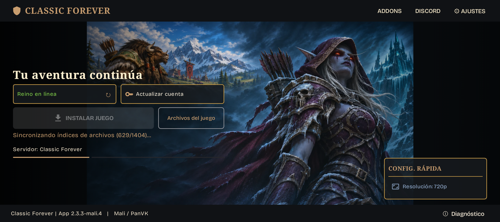

# ClassicForever Android

Aplicación para ejecutar World of Warcraft en dispositivos Android ARM64, con soporte gráfico para Mali/PanVK y Adreno/Turnip.

Este es el repositorio público de **documentación y releases**. Aquí publicaremos los APK que vayamos seleccionando.

## Descargas

La primera versión pública es **[0.0.1](https://github.com/apazosg/ClassicForever-android/releases/tag/v0.0.1)**. Descarga su APK desde [Releases](https://github.com/apazosg/ClassicForever-android/releases).

Cada release indicará los cambios, las instrucciones específicas de esa versión y las limitaciones conocidas. Las publicaciones se realizarán cuando decidamos que una versión está lista para compartir.

Consulta la [numeración y el formato de las notas de publicación](docs/releases.md). Desde `0.0.1`, la aplicación avisa de nuevas versiones publicadas aquí y permite consultar sus novedades y descargar la actualización. En **Ajustes → Buscar actualizaciones** puedes comprobarlo manualmente, incluso sin haber instalado el juego.

## Funcionalidades

- **Instalación del juego desde la aplicación**, con descarga inicial del cliente y descarga progresiva de los datos mientras juegas.
- **Reutilización de una instalación existente**, seleccionando su carpeta o copiando sus archivos desde un ordenador.
- **Actualización del cliente del juego** desde el propio launcher.
- **Soporte gráfico Mali/PanVK y Adreno/Turnip**, según la compatibilidad del dispositivo. No requiere root.
- **Gestión de cuenta y credenciales guardadas**, con contraseñas cifradas mediante Android Keystore y controles para configurarlas, actualizarlas o borrarlas.
- **Selección de región y resolución** de 720p o 1080p.
- **Mandos, controles en pantalla y teclado Android** durante el juego.
- **Superposición de rendimiento y herramientas de diagnóstico** accesibles desde el menú del juego.

La presencia de una función no garantiza que todos los dispositivos o versiones del cliente sean compatibles. Consulta los resultados de pruebas más abajo y las notas del APK que instales.

## Capturas de pantalla

### Instalación del juego

## Requisitos

- Dispositivo **Android ARM64** con GPU y controladores compatibles. En Mali, la compatibilidad depende también del kernel; no basta con tener una GPU Mali.
- Espacio libre suficiente: como referencia, unos **60 GB para los datos del juego**, más aproximadamente **4 GB para la aplicación y su entorno**. El uso inicial es menor y aumenta con la descarga progresiva.
- Conexión a Internet; se recomienda Wi-Fi para las descargas.
- Una cuenta para acceder al juego.

## Instalación y primeros pasos

### 1. Instalar la aplicación

Descarga el APK desde [Releases](https://github.com/apazosg/ClassicForever-android/releases) e instálalo en Android. Si el sistema lo solicita, permite instalar aplicaciones desde la aplicación con la que abras el APK.

Si ya utilizas una compilación anterior, instala `0.0.1` manualmente sobre ella, sin desinstalarla. A partir de esa versión, podrás consultar las siguientes actualizaciones desde la propia aplicación.

Las compilaciones actuales pueden aparecer como **WoW Forever Mali**, con el identificador `app.wowforever.mali`.

### 2. Preparar los archivos del juego

Abre la aplicación y concede el permiso de **acceso a todos los archivos** que solicita para gestionar la carpeta del juego.

- **Instalación nueva:** elige la ubicación y pulsa **Download & Install**. La carpeta predeterminada es `/storage/emulated/0/WoW Forever/`. No hace falta descargar todos los datos antes del primer arranque: el cliente los obtiene según los necesita.
- **Instalación existente:** utiliza **Locate Existing Files** para seleccionar su carpeta. Si copias una instalación desde un ordenador, conserva tanto la carpeta `Data/` como el archivo oculto `.build.info` en la raíz de la carpeta del juego.

### 3. Configurar la aplicación y jugar

1. Configura o actualiza tu cuenta desde la pantalla principal.
2. Ajusta la resolución desde la configuración rápida y revisa las opciones de **Ajustes** si lo necesitas.
3. Con los archivos del juego preparados, inicia el juego desde el launcher. El primer arranque prepara el entorno y puede tardar unos minutos.

### 4. Controles y ajustes durante el juego

- Pulsa **Atrás** para abrir el menú lateral con teclado, controles en pantalla, rendimiento y salida.
- Los mandos utilizan el soporte de gamepad del propio juego.
- Para volver a la configuración cuando la aplicación arranca automáticamente, pulsa Atrás durante la pantalla inicial o mantén **Start + Select + L2 + R2**.
- Los códigos de autenticación adicional, cuando correspondan, se introducen manualmente.

## Dispositivos probados y funcionando

| Dispositivo | Driver probado | Resultado |
| --- | --- | --- |
| **POCO X4 GT** | PanVK — Zenith 26.3.1 | Funciona con pocos FPS (**<20**). |
| **POCO X8 Pro Max** | PanVK — Zenith 26.3.1 | Jugable (**>30 FPS**). |
| **Google Pixel 10a** | Pendiente de confirmar | En pruebas. |

Proyecto comunitario no oficial, sin afiliación ni respaldo de Blizzard Entertainment. Los APK de esta aplicación no incluyen los archivos del juego de Blizzard.
